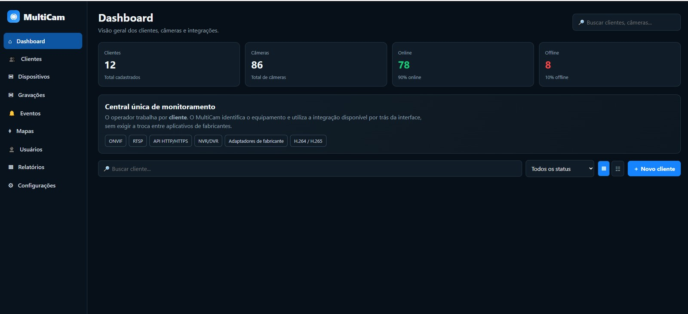

# 🚀 Fernando Garcia Farias
### Desenvolvedor Full Stack | Software Engineering | Cloud & Mobile

Desenvolvedor Full Stack, formado em Desenvolvimento Full Stack (Estácio, 2025), com experiência acadêmica e prática na construção de aplicações web, mobile, APIs, bancos de dados e soluções em nuvem.

Meu foco é desenvolver soluções escaláveis, seguras e funcionais, aplicando boas práticas de engenharia de software, arquitetura, automação e integração de sistemas.

---

## ⭐ Projetos em destaque

### 1. MultiCam — Plataforma de Gerenciamento de CFTV

**Projeto principal | Desenvolvimento contínuo**

Plataforma de gerenciamento centralizado de câmeras e dispositivos de videomonitoramento, com arquitetura modular, autenticação, controle de acesso, banco de dados e descoberta de dispositivos em rede.

**Tecnologias:** JavaScript, Node.js, Fastify, SQLite, JWT.

🔗 [Acessar projeto MultiCam](https://github.com/Futureforworld/MultiCam)

🌐 [Demonstração online](https://futureforworld.github.io/MultiCam/)

### 2. MP_N5 — Segurança de Software

Projeto acadêmico voltado à segurança e às boas práticas de desenvolvimento.

🔗 [Acessar projeto](https://github.com/Futureforworld/MP_N5)

### 3. M5 — Comunicação entre Clientes e Servidores

Desenvolvimento envolvendo sockets, threads e persistência com JPA.

🔗 [Acessar projeto](https://github.com/Futureforworld/M5)  
🌐 [Demonstração online](https://futureforworld.github.io/M5/)

### 4. Angular e TypeScript

Desenvolvimento de aplicações web utilizando componentes, serviços e arquitetura Angular.

🔗 [Livro Angular](https://github.com/Futureforworld/livro-angular)

### 5. Sistema de Persistência

Modelagem de entidades e integração com mecanismos de persistência de dados.

🔗 [Acessar projeto](https://github.com/Futureforworld/Entidades_Sistema_de_Persistencia)  
🌐 [Demonstração online](https://futureforworld.github.io/Entidades_Sistema_de_Persistencia/)

### 6. Azure IoT — Integração com a Nuvem

Projeto de integração envolvendo sensores de temperatura e umidade e visualização de dados.

🔗 [Acessar projeto](https://github.com/Futureforworld/Vamos-interligar-as-coisas-com-a-nuvem)  
🌐 [Demonstração online](https://futureforworld.github.io/Vamos-interligar-as-coisas-com-a-nuvem/)

### 7. Desenvolvimento Mobile — Flutter

Aplicações e experimentos envolvendo widgets, layouts e interfaces mobile.

🔗 [Widget Stack](https://github.com/Futureforworld/widget-Stack)

🔗 [Layouts e Widgets](https://github.com/Futureforworld/Layouts_Widgets)

### 8. Desenvolvimento Web

Projetos utilizando HTML5, CSS3 e JavaScript.

🔗 [Meu primeiro framework](https://github.com/Futureforworld/Meu-primeiro-framework)

🔗 [Site de receitas](https://github.com/Futureforworld/site-receitas)  
🌐 [Demonstração online](https://futureforworld.github.io/site-receitas/)

---

## 🛠️ Competências técnicas

**Linguagens**
- Java
- JavaScript
- Python

**Frontend**
- HTML5
- CSS3
- React
- Angular
- TypeScript

**Backend**
- Node.js
- Express.js
- Java Spring

**Mobile**
- Flutter
- React Native

**Banco de dados**
- MySQL
- PostgreSQL
- SQLite

**Cloud e dados**
- Microsoft Azure
- Azure IoT
- Business Intelligence
- Data Warehouse
- ETL

**Ferramentas**
- Git e GitHub
- Postman
- JupyterLab
- VS Code

---

## 🎓 Formação acadêmica

- Tecnólogo em Desenvolvimento Full Stack — Estácio (2025).
- Técnico Integrado em Administração de Empresas — ETEC (2009–2011).
- Montagem e Configuração de Microcomputadores — SENAI (2004).

## 📜 Certificações

- Microsoft Azure Fundamentals.
- Business Intelligence, Data Warehouse & ETL.
- JavaScript — 40 horas.
- Desenvolvedor Cloud Mobile.

---

## 📫 Contato profissional

- LinkedIn: https://www.linkedin.com/in/fernandogarciafarias/
- GitHub: https://github.com/Futureforworld
- Instagram: @curefordarkness

---

**Fernando Garcia Farias | Desenvolvimento de soluções, tecnologia e inovação.**

<!-- AUTO-PROJECTS:START -->
## Projetos com demonstração online

Projetos com endereço de demonstração validado.

- **[links-parceiros](https://futureforworld.github.io/links-parceiros/)** — [Código-fonte](https://github.com/Futureforworld/links-parceiros) · HTML
- **[login-page](https://futureforworld.github.io/login-page/)** — [Código-fonte](https://github.com/Futureforworld/login-page) · TypeScript
- **[aplicativo_Flutter](https://futureforworld.github.io/aplicativo_Flutter/)** — [Código-fonte](https://github.com/Futureforworld/aplicativo_Flutter)
- **[Widgets_Flutter](https://futureforworld.github.io/Widgets_Flutter/)** — [Código-fonte](https://github.com/Futureforworld/Widgets_Flutter)
- **[Microatividade-1](https://futureforworld.github.io/Microatividade-1/)** — [Código-fonte](https://github.com/Futureforworld/Microatividade-1) · TypeScript
- **[Modelagem_implementa-o_SQL-Server](https://futureforworld.github.io/Modelagem_implementa-o_SQL-Server/)** — [Código-fonte](https://github.com/Futureforworld/Modelagem_implementa-o_SQL-Server) · TSQL
- **[livro-servidor](https://futureforworld.github.io/livro-servidor/)** — [Código-fonte](https://github.com/Futureforworld/livro-servidor) · JavaScript
- **[formulario.html.css](https://futureforworld.github.io/formulario.html.css/)** — [Código-fonte](https://github.com/Futureforworld/formulario.html.css) · HTML

## Outros repositórios públicos

Projetos disponíveis para consulta do código-fonte.

- [MP-N4](https://github.com/Futureforworld/MP-N4) — Jupyter Notebook
- [Miss-o-Pr-tica_N3](https://github.com/Futureforworld/Miss-o-Pr-tica_N3)
- [M-quina_Virtual-VM-_Azure](https://github.com/Futureforworld/M-quina_Virtual-VM-_Azure)
- [Miss-o_Pratica_Nivel_3_MP](https://github.com/Futureforworld/Miss-o_Pratica_Nivel_3_MP)
- [Miss-o_Pratica_Nivel_3](https://github.com/Futureforworld/Miss-o_Pratica_Nivel_3)
- [Widget.ListView_Flutter](https://github.com/Futureforworld/Widget.ListView_Flutter)
- [preparando_ambiente](https://github.com/Futureforworld/preparando_ambiente)
- [Microatividade5](https://github.com/Futureforworld/Microatividade5)
- [Microatividade4](https://github.com/Futureforworld/Microatividade4)
- [Microatividade3](https://github.com/Futureforworld/Microatividade3)
- [Microatividade2](https://github.com/Futureforworld/Microatividade2)
- [Cadastro_em_Modo_Texto](https://github.com/Futureforworld/Cadastro_em_Modo_Texto)

<!-- AUTO-PROJECTS:END -->